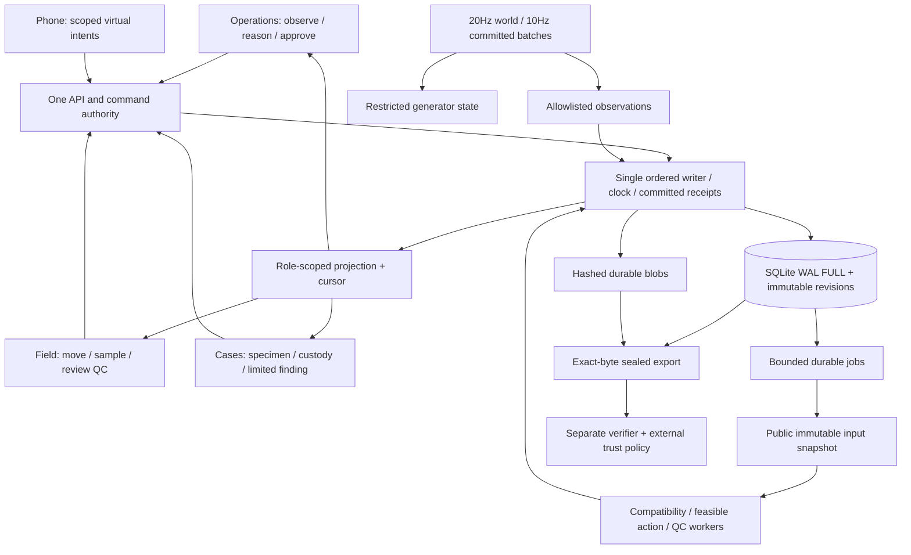
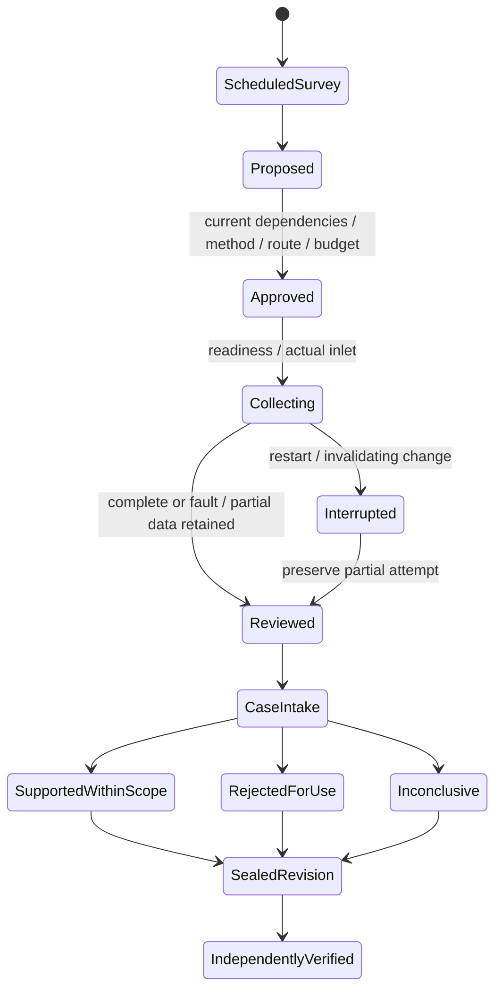

# FuelPrint R3 Implementation Plan

> Planning revision IP-R3-1, 15 October 2026. For later execution use the executing-plans skill, task by task, after Aditya explicitly authorizes the build. All checkboxes are future work. No application build, installation, procurement, outreach, deployment or physical trial is authorized by this document.

**Goal:** build a recoverable investigation record across Operations, Field and Cases, then expand it into the complete causal software exhibition and a separately qualified physical route.

**Architecture:** three browser applications use one authenticated Python authority, one SQLite database and one immutable blob store. The authority owns state, the clock and accepted commands; bounded scientific workers consume immutable public snapshots. A separate verifier checks saved evidence against independently supplied trust.

**Stack:** R3 candidates: React/Vite/TypeScript/direct Three.js, FastAPI/Python, sqlite3/explicit SQL, NumPy/SciPy, strict JSON Schema, Ed25519. Exact candidates and lock gate are in section 02 and the unchanged R3 dependency register.

## Binding scope and authority

The completed R3 research is the design authority. The references directory contains unchanged copies and source hashes; the original sealed folder and historical P2.1 folder remain untouched. This plan translates the research into implementation work. It does not repeat the research programme, check Drive, execute old tasks or claim an installed stack. Where this plan supplies missing engineering details, decisions IP01–IP18 in section 02 apply. R3 scientific/physical limits remain binding.

The selected route is a vertical slice, followed by modular expansion. Two alternatives were considered: building all app screens independently would postpone persistence/integration defects; starting with hardware would block on unperformed access and qualification. The vertical slice gives an early, inspectable product gate and keeps physical spending conditional.

Global constraints:

- Exactly five responsibility slots: O1 and O2 Operations; C1 and C2 Cases; A is Aditya, Field/gaming/3D. Slots are assignments, not claims of personal expertise or availability. No sixth developer exists.
- Shared backend is allocated to O1/O2/C1/C2. C1 owns storage/clock/evidence and schema review; C2 owns control, adapter, specimen/lab and integration gates. Aditya owns the whole Field presentation, including phones, vehicles, cutaways and workbench.
- Every science value names origin, units, method/profile, time domain, uncertainty and lineage. Synthetic teaching, blind synthetic and physical observations cannot be pooled as one undifferentiated result.
- First product milestone is all three outcomes through all three apps, saved records, restart recovery and reproducible evidence. Toolchain/storage component work is inside M1, not a replacement milestone.
- All 92 questions, 25 Antigravity findings, 28 features, 32 coding decisions, 92 exact fixtures and 137 inherited acceptance specifications survive. All 33 unsupported software-test flags remain active. No document check clears them.
- Physical P0–P6 are all NOT_PERFORMED. R3's 769 checks were documentary/arithmetic; no FuelPrint app/device/physical acceptance has run.
- Preserve 25 false singles/240 historical episodes, including mixture/met failures; missing surveyed stacks/fuel labels; possible zero useful actions; Gaussian-family evaluation limits; and no secured customer/provider/quote/registration receipt.
- Contributed labor and covered existing tools make software cash conditionally ₹0. Actual cost, ownership, operating expenses and working capital remain separate.

## What the five people own

| Slot | Primary output | Shared backend responsibility | Cross-review focus |
|---|---|---|---|
| O1 | Operations placement, approval, board, deterministic explanations | Command authority/auth/jobs; feasible actions; release claims | Clock/recovery, controls, evidence restrictions |
| O2 | Measurement health, scientific observations and reasoning | World/history, inlet/response/covariance, compatibility solver | Field causality, numerical oracles, evaluation fairness |
| C1 | Vault, full Cases integration and evaluation report | SQL/blob storage, clock/projection, pack/verifier, evaluation harness | Schemas, uncertainty accounting, custody/lineage |
| C2 | Cases intake, material/custody/lab workflows | Pairing/leases/deadman, adapter ingest, end-to-end/restore/device gates | Auth, Operations states, final metrics |
| Aditya | Field, gaming, whole 3D environment, phone/keyboard UI | Public projection consumer and authorized intents; no separate simulation authority | Geometry transforms, accessible Field, visual causality |

Teammates implement within these slots; no assumed specialties. If competent electrical/lab/flight reviewers are unavailable, physical gates remain blocked. Such external competence is a later qualification prerequisite, not an extra software developer hidden in the estimate. Cross-review does not establish independent professional certification.

## How the system connects

Operations asks what was observed and whether a feasible next measurement exists. Field carries out an approved virtual action at the actual inlet, with real simulated delay, flow and failures. Cases records what those observations support, keeps specimens separate, and saves the evidence and its limitations. A rejected or inconclusive record is as complete as a supported one.

Private generator state and final labels live in a separately restricted directory/database. Public domain data has no truth pointer that a generic serializer follows. Production inference processes cannot open the private directory and do not import generator modules. Observation production crosses the boundary once through a typed allowlist. Physical adapters use that same observation boundary with provisioned identity and real capture times; they do not borrow teaching qualification.

## First milestone, M1: complete three-outcome slice

Scope: plain usable Operations health/investigation/approval/board, Field mission/capture/QC with a minimal actual inlet marker, Cases intake/finding/vault, role-scoped timeline, simple online fixture producer, durable commands/jobs/records/blobs, a bounded minimal pack and separate verifier, read-only replay and restart. Rich context, mobile navigation, new solver, phones, specimens, laboratory and full evaluation are later gates. The M1 producer is openly `TEACH-M1-ONLINE-1`, an already-ready synthetic fixture, never the full physical model.

| Journey | Operations | Field | Cases and evidence | Exact acceptance |
|---|---|---|---|---|
| M1-V valid | Create independent scheduled survey, approve channels/method/use and current dependency hash | 30 consecutive valid 1s intervals at SO₂ 0.5 and CO₂ 0.3 actual L/min, 100ppb/20ppm fixture enhancement | SUPPORTED_WITHIN_SCOPE for the named synthetic observation; no source/fuel verdict; seal and verify | 0.25L SO₂, 0.15L CO₂; 30 valid seconds/channel; raw bytes and input refs retained |
| M1-R rejected | Same setup, show raw value alongside failure reason | At collection second10, SO₂ flow becomes zero while plausible raw value persists; close partial failed attempt, require new approval for a new attempt | REJECTED_FOR_NAMED_USE for SO₂ and dependent ratio; healthy CO₂ separately usable; failed record still seals | No added SO₂ volume after fault; partial pre-fault 10s gives 0.0833333333L but no valid 30s SO₂ window; CO₂ may complete 0.15L |
| M1-I inconclusive | Fixture has proportional public response columns [1,2] and [2,4] for y=[3,6]; all proposed discrimination gaps overlap | Valid observation retained, or explicitly rejected inaccessible action; no fabricated motion/measurement to end scene | INCONCLUSIVE with NON_IDENTIFIABLE_PATTERNS or NO_USEFUL_MEASUREMENT; alternatives/stop preserved | Both amplitudes 3 and1.5 give SSE0; no qualified source; numeric replay same within stated tolerance |

M1-R record is not described as zero total historical volume. The fault contributes zero **new** valid SO₂ volume; prior good data remains. Per-channel validity controls downstream use. A QC reviewer cannot override the missing 30s window.

M1-I uses a restricted analytical fixture, not the unbuilt FP-COMPAT-3 solver; UI and export name that fixture. M1 does not earn model qualification or attribution performance. Full-solver eligibility remains MODEL_NOT_QUALIFIED until M6 evidence supports a named synthetic scope.

M1 gate runs each journey through actual APIs and all three production app routes, with backend IDs/revisions asserted alongside browser actions. Kill the authority during a capture and after a transaction commits but before its response; retry the same key. Committed records survive with one effect; active work becomes interrupted, leases revoked and readiness/reapproval required. Recover within the target120s on the supported host, or record a smaller supported envelope/failure. Export on host and verify on another available laptop with separately supplied public-key fingerprint. An automated separate process checks the trust boundary; it does not substitute for the actual-device rehearsal.

Evidence reproduction means: same saved public inputs/configuration reproduce calculations within frozen tolerances; same sealed file retains identical SHA256/signature bytes; subsequent exports of a different case revision are new exports, not expected to have identical bytes. It does not reconstruct an unobserved physical event. M1 passes only with actual records, raw outputs, code/config/fixture hashes and cross-role review. At planning delivery M1 status is NOT_STARTED.
