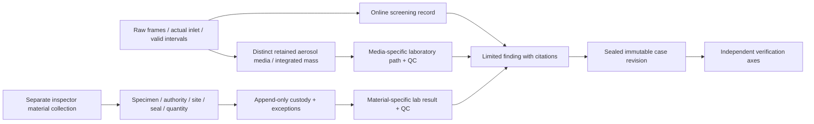

# 04 — Cases, distinct samples and evidence verification

## Three different evidence products

Online screening is a saved observation of ambient gas through a named chain. Retained media is an actual distinct cassette/container with accumulated mass and history. An inspector specimen is separately collected material with site, authority, container, seal and holder history. IDs/types cannot substitute for one another. A valid online record does not create a coal specimen, a filter pore size does not create PM₂.₅, and a signed file does not establish custody, physical truth or legal use.

W22/C2 creates specimen and custody; W23/C2 implements material/media laboratory arithmetic and method guards; W25/C1 integrates the Cases UI. Aditya supplies the 3D specimen/lab workbench from those authoritative records, never parallel laboratory logic.

## Selected methods and exact teaching oracles

| Method | Collection / readiness | QC / interpretation | Task |
|---|---|---|---|
| TEACH-M1-ONLINE-1 | Already-ready fixture,30 consecutive valid seconds; SO₂0.5/CO₂0.3actual L/min;100ppb/20ppm enhancement | Volumes0.25/0.15L; named synthetic online use only; no source qualification | W05/M1 |
| TEACH-NODE-ONLINE-2 | Cold warmup120s, purge30s, settle≥120s and modeled error≤5%;30consecutive valid seconds, flows±5% around0.5/0.3; recovery≤5% before reuse | Per-channel valid/limited/rejected; response history not reset by starting capture | W12 |
| TEACH-AEROSOL-S-1 | Unclassified aerosol, distinct cassette/lot/seal;2actual L/min×600valid seconds; teaching efficiency1 for oracle | Analyte LOQ0.10µg, blank≤0.02µg, duplicate RPD≤20%, recovery80–120%, hold seal→analysis≤300simseconds | W12/W23 |
| TEACH-FUEL-S-1 | Separately collected synthetic coal/coke-like material,≥50mg (worked100mg); total sulfur | LOQ0.01%w/w, blank≤20µg, RPD≤20%, recovery80–120%, hold≤300simseconds; limited material assay only | W22/W23 |
| Physical online SO₂ | Actual qualified N100/reference method/serial/inlet/time/uncertainty domain | No teaching thresholds/certificate substitution; relevant P gates required | Later H-C/H-D |
| Physical retained reactive gas | Disabled | Needs actual target/path/container/RH/T/concentration/holding recovery evidence before enablement | Later H-E only if funded/qualified |

Profiles carry UUID,label,revision,hash,origin,purpose/material/analyte,units,required inputs/readiness/holding rules and qualification source. Every teaching profile is SYNTHETIC_ONLY with ENGINEERING_TEACHING_ALLOCATION. A physical adapter cannot select one to earn validity.

Aerosol oracle:2L/min×600s/60/1000=.020m³. At1000µg/m³, total20µg and1%analyte.20µg, potentially above.10µg LOQ with QC. At250µg/m³, total5µg/analyte.05µg -> BELOW_REPORTING_LIMIT. Efficiency/invalid intervals change usable mass; unknown efficiency never defaults to1 outside the named teaching oracle. Zero flow adds zero mass. Do not replace analyte mass with total aerosol mass.

Material oracle:100mg specimen, gross sulfur2010µg−blank10µg=net2000µg;100×2000/(100×1000)=2.0%w/w. Duplicate2.0/2.2% gives RPD9.5238095%;90µg recovered/100µg spike gives90%. Blank30µg fails the20µg limit even if a corrected number looks plausible. Store raw, blank, correction and every failed QC reason. RPD with mean zero is undefined unless both zero under a specifically qualified rule; mark unavailable/limited, never divide by zero. Recovery requires positive documented spike mass; missing required QC produces PENDING/REJECTED for use, not an assumed pass. Below-LOQ is not zero or absence of source.

For future physical coal/coke sulfur, ASTM D4239-26 is the selected public method **family**. Only public scope/version was inspected; no paid normative procedure is acquired here. Actual laboratory supplies licensed procedure, material preparation/basis/mass, uncertainty/reporting limit, validation/QC/hold and current accreditation scope. A NABL logo does not establish the relevant method scope or statutory authority. Ash/liquid fuel/arbitrary aerosol do not inherit coal/coke scope. Physical PM₂.₅ needs an actual qualified aerodynamic selector, prescribed actual flow, media conditioning and laboratory method; SPS30 optical estimates and membrane pore size do not provide that qualification.

## Specimen/custody/laboratory state and failure behavior

Collection stores site/material/actual quantity/unit, time/domain/uncertainty, authority basis, collector, method revision, container/media lot, seal and conditions. Server resolves restricted actual teaching material independently of selected suspect. Hash/ID do not leak generator material; public lab output contains actual measured/raw analytical data only. Changing selected suspect with unchanged specimen inputs must leave analytical result identical.

Custody starts with collector holder and appends transfer request/receipt/exception, from/to, event time and recorded time, seal, conditions, actual signatories and predecessor revision. No editing history. Absent/refused recipient, broken/missing seal, late transfer and mistaken entry use explicit exception/correction events. A reviewer can document an observed exception without impersonating current holder. Laboratory receipt may record broken custody and still perform an analysis; finding policy restricts relevance/use separately.

A wrong-site specimen can contain sulfur. Report analytical result and wrong-site/lineage limitation, never scripted clean/guilty. “Supported within scope” can mean a valid2% material sulfur result on that specimen; it cannot mean that material caused the ambient plume, identifies fuel legality or implicates the chosen factory. Legal suitability remains NOT_ASSESSED in the UI and UNVERIFIED in evidence enum, with explanatory code LEGAL_SUITABILITY_NOT_ASSESSED. Inspector_demo grants no real access/sampling power. Current actual authority/forms/method/laboratory suitability are P0/P4 prerequisites, not a form copied into the app.

## Exact-byte evidence product

W09 provides a bounded minimal M1 archive; W24 adds full raw chunking, lineage/media/custody/trust/adversarial coverage. Both preserve `fp.evidence/1` and signature bytes `UTF8("FuelPrint evidence v1\n") || exact_manifest_bytes`. Ed25519 signs these exact stored bytes. Never decode/reorder/re-serialize a manifest before signature verification. Commands use JCS hashing; evidence uses exact stored bytes. Keep deterministic serializer policy/version for producing a manifest and store the produced bytes immutably. Creation time is self-declared unless independently anchored.

The signed manifest lists schema/model/profile/algorithm hashes, export/case revision, origin/time domain, members(path,length,SHA256,media_type), immutable record refs/citation edges, declared omissions/limitations (no silent omitted cited evidence), and signing key ID. Public verification receives its trusted key/fingerprint and revocation policy out of band; any in-pack key is untrusted informational material. Signing key is provisioned/stored on host outside repo/browser/export, accessed only for explicit sealing. Key loss/compromise triggers revoke-and-review; never backdate a fresh signature to regain trust. Public key copy/check on a second laptop is an actual gate, not a claimed independent reviewer.

Raw frames are grouped in≤1MiB encoded NDJSON chunks, with frame_id,raw_sha256,raw_bytes and strict base64 of **original accepted raw bytes**. An indexed metadata member links each frame to device/boot/sequence/capture time/profile/origin and chunk location. Individual decoded raw≤64KiB, repeated frame IDs/conflicting indexes fail. Hash every chunk as stored and every decoded raw payload; decoded lengths/hash must match indexed immutable records.4500raw frames (5×900s) must fit actual measured case size and≤500members, rather than4500separate files. If full cited content exceeds limits, refuse sealing; an explicitly narrower newly reviewed case revision is permissible, silent dropping is not.

Archive policy remains25MiBcompressed,100MiBexpanded,20MiB/member,500members including envelopes,100:1ratio,manifest≤1MiB. Raw chunk encoded cap1MiB; decoded totals count additionally against100MiB verification-work allowance. Enforce limits incrementally before allocation, and inspect ZIP central/local metadata consistency and flags. Use canonical ASCII `[a-zA-Z0-9._/-]` POSIX relative payload names, depth≤8/path≤240bytes; reject case-fold and Unicode-normalization collisions, fixed `manifest.json` and `manifest.sig`, payload names under `payload/`; manifest enumerates payload members only (not recursive envelopes); allowlist payload directories/types, reject absolute/drive/backslash/NUL/dotdot names, duplicate entries/keys, symlink/special files, encryption, unknown required format versions, extras/missing unsigned files, length/hash/index mismatches and malicious compression. Never extract paths. Numeric/string/depth limits apply to every parsed JSON member; bound nesting32, typed arrays by contract and streams by size. ZIP file comments/entry metadata are not trusted claims.

Verification order: bounded archive preflight; read exact manifest bytes; strict parse plus schema/size/path checks; verify domain-prefixed signature against supplied key policy; hash/length all allowlisted members; decode/check chunks with bounded accounting; validate referential lineage/origin/method citations; emit seven independent axes. Semantic parsing never executes embedded code/templates. A hash failure prevents claiming downstream semantic validity from those bytes.

| Axis | What a pass could establish | What it cannot establish |
|---|---|---|
| Integrity | Exact bytes match signed manifest/key's signature | Honest capture, correct calibration, real event |
| Key trust | Supplied independent policy trusts signer/current status | Historical validity from self-declared date; no revocation escape |
| Lineage | Declared refs/versions/hashes link completely within stated pack | Unrecorded external relationships or custody |
| Trusted time | Actual independent anchor if available | Manifest's own UTC as independent evidence; otherwise UNVERIFIED |
| Custody documentation | Declared holder/seal chain satisfies stated policy | Whether unrecorded real transfers occurred |
| Measurement qualification | Required method/domain/calibration/QC records satisfy named use | Source guilt, fuel legality, field validity from synthetic success |
| Legal suitability | Actual current competent site/use review if supplied | Legal admissibility from a signature or demo form; exhibition remains unassessed |

Verifier CLI entry `python -m verifier <pack> --trust-policy <external-file>` is a future interface. It returns machine-readable axis results/reasons and nonzero exit for structural/integrity failure; unverified time/legal/custody are explicit, not hidden behind a single green “verified” badge. Cases shows the same distinctions. Rejected/inconclusive cases can pass byte integrity while measurement or scope remains failed/limited.

Attack tests include each size/count/ratio threshold at limit and+1, duplicate ZIP names/manifests/JSON keys, path/symlink attacks, unsupported schemas, wrong/revoked/in-pack substituted key, self-backdating, changed payload/manifest/signature, extra/missing members, chunk base64 malformed/oversize/duplicate/index mismatch, private-canary scans, conflicting origin and incomplete citation graphs. A copied export is tampered in EX07; the original stays unchanged. A measured4500frame case proves actual packaging capacity; no average frame-size assumption is sufficient. Export jobs and restore tests pin exact bytes/hash and never re-sign on read.
